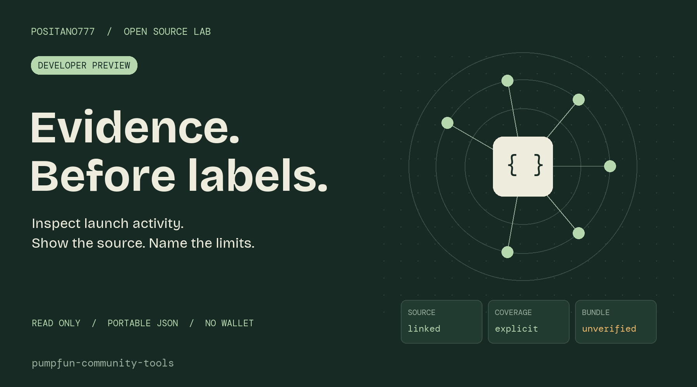
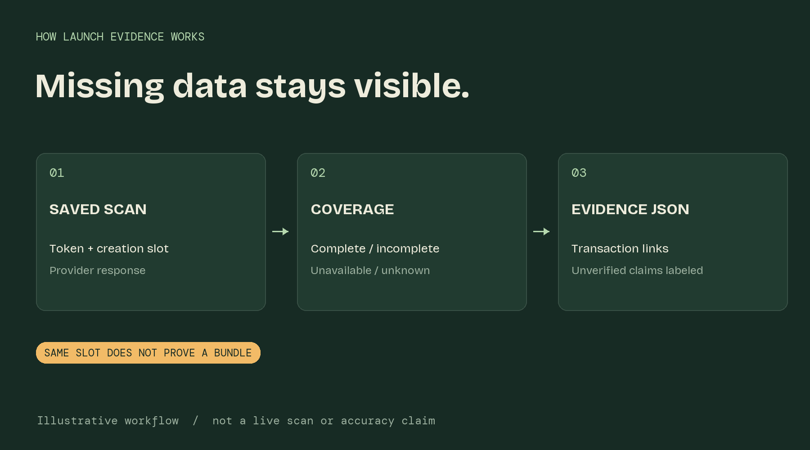

# Pumpfun Community Tools

Open-source tools for inspecting Solana launches and sharing reproducible evidence. Maintained by [Positano777](https://x.com/positano777).

**Developer preview.** This is an attributed [RugHawk](https://github.com/bobvasic/rughawk) fork, originally built by RaptorLabs under MIT. Read [upstream attribution and changes](UPSTREAM.md). The inherited application and its branding are preserved; no hosted Positano service is deployed.

## Available now

- **[Where did my SOL go?](receipt/README.md)**: standalone transaction receipts, offline browser viewer, supported native flows, token changes, network fee, and explicit unexplained amounts. No signing or wallet connection.
- Launch findings distinguish observed token gains from unverified purchases, coordination, and bundle membership.
- Top-holder absence is no longer presented as proof of a sale.
- Offline launch-evidence export from a saved token scan, with explicit coverage limits and source transaction links.
- Exact-slot block coverage: complete provider response, incomplete sample, unavailable block, or unknown legacy coverage.
- Per-transaction launch-slot token-gain evidence.
- Raw diagnostic strings and unknown outflow extensions are omitted from exports.
- Synthetic fixtures and regression tests. Fixtures are examples, not real launch evidence.

## Who this helps

| User | Useful workflow |
| --- | --- |
| Token researcher | Inspect creation-slot activity and follow transaction links |
| Community moderator | Share a portable report with explicit coverage limits |
| Integration developer | Reproduce observations from a saved scan and add fixtures |



## Try the export

For the new receipt tool, [download the offline viewer](receipt/viewer.html) or follow the [CLI examples](receipt/README.md#command-line). It needs no npm install. The receipt is a preview with partial instruction attribution, not full trading PnL.

Requires Node.js 22 or later. The standalone command has **zero package dependencies**; no install is needed.

```sh
node evidence/cli.mjs examples/launch-synthetic.json
node evidence/cli.mjs examples/launch-synthetic.json evidence.json
node --test evidence/cli.test.mjs
```

The offline export needs no wallet, API key, or network request. It formats supplied scan data; it does not independently verify the blockchain. It deliberately does not report a token as safe or prove Jito membership. Existing output files are never overwritten.

Read [validation results and limits](VALIDATION.md) before using the inherited full application. All 90 TypeScript tests passed in an isolated engine environment; full web-app installation and build remain unverified. GitHub Actions is disabled for this fork.

## Use a real scan

Follow the RPC setup in [upstream documentation](UPSTREAM_README.md#run-it), then:

```sh
npm run scan -- token <mint> scan.json
npm run evidence -- scan.json evidence.json
```

Archive RPC retention, upstream sampling, fee-payer attribution, and scan errors affect coverage. A located creation transaction does not mean every launch-slot transaction was inspected. The export records that limitation even when no warnings are supplied. Self-hosting infrastructure may cost money.

## Roadmap

- **Shipped:** block-fetch/sample coverage and transaction-level launch-slot observations.
- **Next:** independently checked real replay fixtures and stronger buyer attribution.
- **Planned:** creator outflow alerts and transport adapters.
- **Planned:** paper-trading/execution adapters after compatibility and signing review.

Trading automation is not newly implemented or validated in this preview. See the [community catalog](https://github.com/Positano777/awesome-pumpfun-open-source) for execution candidates and research status.

## Read an export correctly

`coverage.launchBlock` describes the RPC response, not whether a token is safe. A truncated sample is `incomplete`; a failed fetch is `unavailable`. Older saved scans remain `unknown`. Even a complete response does not prove a purchase, common control, or Jito bundle membership.

`launchSlotObservations.transactions` links sampled positive fee-payer token deltas to source transactions. Transfers and repeated movement can contribute to the aggregate; this is not necessarily unique supply held.

Read the [credential review](docs/SECURITY_REVIEW.md), [security guidance](SECURITY.md), and [validation notes](VALIDATION.md). The historical scan had two reviewed false positives, not confirmed live credentials; that is not a guarantee of absence.

## Contribute

Read [CONTRIBUTING.md](CONTRIBUTING.md). Useful contributions include reproducible false positives, decoder coverage, missing-history fixtures, and upstream-compatible fixes. Never post private keys or credential-bearing RPC URLs.

## License

MIT. Original RugHawk copyright and license are preserved in [LICENSE](LICENSE). New community contributions are made under the same license.
